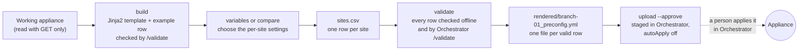

# edgeconnect-preconfig

[](https://github.com/Crypto-Gi/edgeconnect-preconfig/actions/workflows/test.yml)
[](LICENSE)
[](requirements.txt)
[](docs/TESTING_AND_VERIFICATION.md)
[](https://agentskills.io)

**Turn one HPE Aruba EdgeConnect appliance into a CSV-driven preconfig template for every site.**

For SD-WAN engineers who stage many branches: read a working appliance (GET only), pick which settings change per site, fill one CSV row per site, and get one Orchestrator-validated preconfig YAML per row, ready to upload. It never applies anything.

Verified on real hardware: 65 appliances (ECOS 9.3.7 to 9.7.2) captured and validated across Orchestrator 9.6.4, 9.7.1 and 10.0.0, and rendered preconfigs applied and diffed leaf by leaf on lab appliances ([verification report](docs/TESTING_AND_VERIFICATION.md)).

<p align="center">
  
</p>
<p align="center"><sub>A real run on a lab Orchestrator; names and addresses replaced. Upload is shown without <code>--approve</code>, so nothing was sent.</sub></p>

## Contents

- [How it works](#how-it-works)
- [Quick start](#quick-start)
- [Why not write the YAML by hand?](#why-not-write-the-yaml-by-hand)
- [Commands](#commands)
- [Local web GUI](#local-web-gui)
- [Use it with an AI agent](#use-it-with-an-ai-agent)
- [Safety](#safety)
- [The EdgeConnect toolkit](#the-edgeconnect-toolkit)
- [Tests and contributing](#tests-and-contributing)

## How it works



Rows that fail are reported and skipped; the rest carry on. A row whose name or serial is already on the Orchestrator is skipped at upload.

## Quick start

You need an Orchestrator API key: every command reads from or validates on an Orchestrator.

**1. Install** (macOS and Linux; git, Python 3.9+, and Node.js 18+ for the agent skills). The script asks a few questions; [docs/INSTALL.md](docs/INSTALL.md) explains each one and the manual install.

```bash
bash <(curl -fsSL https://raw.githubusercontent.com/Crypto-Gi/edgeconnect-preconfig/main/setup.sh)
```

**2. Fill in `.env`** in the install folder: one nickname per Orchestrator, and the ones `/validate` may run on. Every key and the values it accepts are in [`.env.example`](.env.example).

```dotenv
orch_1=lab
lab_base_url=https://orchestrator.example.com
lab_api_key=<API_KEY>
EC_VALIDATORS=lab
```

**3. Build, choose, validate, upload:**

```bash
edgeconnect-preconfig list --orchestrator lab
edgeconnect-preconfig build --orchestrator lab --appliance 2.NE
edgeconnect-preconfig variables preconfig-output/ref-branch --pick top10 --yes --name branch
# add one row per site to preconfig-output/ref-branch/site-branch/sites.csv, then:
edgeconnect-preconfig validate preconfig-output/ref-branch/site-branch --csv preconfig-output/ref-branch/site-branch/sites.csv
edgeconnect-preconfig upload preconfig-output/ref-branch/site-branch --csv preconfig-output/ref-branch/site-branch/sites.csv
```

What `build` prints (the run in the demo above):

```text
reading 2.NE from lab (GET only) ...
converting for Orchestrator release 9.7.1.42046 ...
checking and validating on lab ...

Saved ~/edgeconnect/preconfig-output/ref-branch  (/validate on lab: accepted)
  reference.yaml      the appliance as preconfig YAML
  ref-branch.jinja2   the template
  ref-branch.csv      empty sheet (headers only) for new sites
  example.csv         this appliance's own values, secrets blank - copy it to start your sites.csv
  summary.md          what was carried and what was not; verdict: Incomplete for preconfig: 4 gap(s), 0 toolkit error(s).

Next: choose the per-site settings
  edgeconnect-preconfig variables ~/edgeconnect/preconfig-output/ref-branch
or let other sites of the same design choose them
  edgeconnect-preconfig compare ~/edgeconnect/preconfig-output/ref-branch <site> <site>
```

The folder is named after the appliance's hostname. `ref-branch.csv` is an empty sheet for new sites; `example.csv` holds this appliance's own row. `summary.md` lists every item the YAML does not carry, so you know what to set by hand. A read the converter does not expect (a new release's payload, an item of another shape) does not stop the build: that part is listed in `summary.md` and the rest is written ([decision 0015](docs/decisions/0015-unexpected-config-runs-with-warnings.md)). What `upload` prints without `--approve`, for a `sites.csv` with one bad address:

```text
checking (no upload without --approve) sites.csv on lab ...
ROW  1 | VALID    | branch-01_preconfig      | .yml written immediately -> preconfig-output/ref-branch/site-branch/rendered/branch-01_preconfig.yml
ROW  2 | VALID    | branch-02_preconfig      | .yml written immediately -> preconfig-output/ref-branch/site-branch/rendered/branch-02_preconfig.yml
ROW  3 | INVALID  | branch-03_preconfig      | skipped (no .yml written): wan1_ip: '198.51.100.300/24' is not an address with prefix length (address with prefix length, e.g. 192.0.2.1/24, blank when wan1_addressing_mode is not static)

Summary: total=3 | valid_yaml_written=2 | invalid_skipped=1 | conflict_skipped=0 | uploaded=0 | upload_failed=0
Approval required: review the rows above and re-run with --approve to upload the 2 ready row(s).
```

Run the same `upload` with `--approve` to stage the ready rows in Orchestrator.

Every command also appends one line to `reports/preconfig.jsonl` in the current folder (file mode 0600, secret cells replaced by `<SECRET:column>`), in the format of the automation tools' report log, so `edgeconnect-auto report summarize reports/preconfig.jsonl` reads it. Set `EDGECONNECT_REPORT_DIR` to log elsewhere, or to an empty value to turn the log off.

## Why not write the YAML by hand?

| | By hand (a text editor or Orchestrator's preconfiguration page) | edgeconnect-preconfig |
|---|---|---|
| Starting point | The default template: 41 sections to fill | A working appliance's own configuration, read with GET only |
| Per-site values | Edit a copy of the file for every site | One CSV row per site; you choose which settings vary |
| YAML pitfalls | YAML 1.1 parsers turn route target `1:1` into `61` and break ZIP code `08034` | YAML 1.2 handling keeps them as written |
| Checking | By eye, then whatever Orchestrator reports | Every cell checked offline, every row by Orchestrator `/validate` before its file is written |
| Secrets | In the files you pass around | Redacted to `<SECRET:path>` in captures; left blank in the CSV |
| Existing preconfigs | Not checked for you | Rows whose name or serial already exists are skipped |
| What it misses | Not recorded | `summary.md` lists every item the YAML does not carry |

## Commands

| Command | What it does |
|---|---|
| `list --orchestrator NICK [--search TEXT]` | Tests the `.env` profile and lists the appliances |
| `preconfigs --orchestrator NICK [--show NAME\|ID]` | Lists the preconfigs already on the Orchestrator, or prints one as YAML with secrets as `<SECRET:path>`; GET only. A YAML with an alias (`*name`, `<<:`) is refused |
| `build --orchestrator NICK --appliance NAME\|nePk [--out DIR] [--validate-on NICK] [--target-release REL] [--target-ecos ECOS]` | Reads the appliance (GET only), converts it, and keeps the folder only if `/validate` accepts it. `--target-ecos` (for example `9.6.2.1`), the ECOS of the appliances the preconfig is for, is optional: it is recorded in `build.json` and the summary, and no rule depends on it at present |
| `variables FOLDER [--pick top10\|top20\|all] [--set COL,...] [--fix COL,...] [--name NAME] [--yes] [--dry-run]` | Choose the per-site settings: Top 10, Top 20 or all, by section; `--dry-run` prints the columns and writes nothing |
| `compare FOLDER SITE [SITE ...] [--set COL,...] [--fix COL,...] [--captures DIR ...] [--name NAME] [--yes] [--dry-run]` | Let 1 to 4 other sites of the same design choose them; a CSV row per site, except a site whose settings differ in shape (a Note names it). A differing zone, label, segment or firewall mode is a ticked column ([decision 0018](docs/decisions/0018-compare-offers-differing-layout-as-columns.md)) |
| `validate FOLDER --csv FILE` | Validates every row; writes `rendered/<preconfig_name>.yml` for those that pass |
| `upload FOLDER --csv FILE [--approve]` | Validates again, skips conflicts, and uploads only with `--approve` |
| `validate --yaml FILE\|DIR ... --orchestrator NICK` | Checks existing preconfig YAML files (shape, `<SECRET:` placeholders, `/validate`, name and serial conflicts); never writes |
| `upload --yaml FILE\|DIR ... --orchestrator NICK [--name NAME] [--serial SERIAL]` | Makes the same checks and uploads every file that passes, without `--approve` ([decision 0017](docs/decisions/0017-upload-yaml-needs-no-approve.md)); the name is the file name unless `--name` (one file only) |

Every option, the messages a command can stop with and what to do, the stage scripts and the output folders: [docs/COMMAND_LINE.md](docs/COMMAND_LINE.md).

## Local web GUI

The same commands in a browser, on this computer only. It is new in 1.4.0-rc.1, a pre-release from the `gui` branch; `setup.sh` installs `main`, which does not have it yet, and `edgeconnect-preconfig` has no `gui` command. From a clone of the `gui` branch, in a Python environment with `requirements.txt` installed:

```bash
python3 -m toolkit.gui                          # from the repository folder; opens your browser; Ctrl+C stops it
python3 -m toolkit.gui --port 8765 --no-browser # a fixed port; prints the sign-in link instead
```

It listens on 127.0.0.1 only, on any free port unless `--port` names one, and prints a sign-in link that works once. It reads the same `.env` as the command line (`EC_DOTENV` names another) and writes to `preconfig-output/` and `reports/` in the current folder (`EDGECONNECT_REPORT_DIR` names another log folder), where everything stays after it stops.

| Screen | What it does |
|---|---|
| Home | Every Orchestrator in `.env` checked at once (green, amber or red, validator yes or no, uploads on or off), the tasks of this session, and the earlier builds with their template and CSV to download |
| Build a template from an appliance | Pick an appliance, choose a validator, and `build`; shows `summary.md` |
| Choose what changes per site | Tick boxes by section (Top 10, Top 20, All) beside a read-only `reference.yaml`; Save downloads the template and `sites.csv` |
| Compare with other sites | On the same screen: tick up to 4 sites of the same design and start from what differs |
| Make the preconfig files | Choose your template and filled CSV: create the YAML files, create and validate, or create, validate and upload |
| Check or upload existing YAML files | `validate --yaml` and `upload --yaml` |
| Inventory | The appliances and the preconfigs on the Orchestrator; open one to read its YAML, secrets as `<SECRET:path>` |
| See what changed | The run log, one run at a time with every row it touched |

Uploads are off until you set `<nickname>_gui_preconfig_uploads=on` in `.env` for that Orchestrator; with it off, no upload goes there, and none of an upload's own requests either (its name and serial check, its `/validate`). Reads, builds and `/validate` on a validator still run. A CSV upload shows the ready rows first and needs that Orchestrator's nickname typed to approve; the approval works once and for those rows only. An upload of existing YAML files is one button, as `upload --yaml` needs no `--approve` ([decision 0017](docs/decisions/0017-upload-yaml-needs-no-approve.md)). The GUI never applies a preconfig: every upload is staged with `autoApply` off. More: [docs/GUI.md](docs/GUI.md).

## Use it with an AI agent

The command line needs no agent; it runs from `toolkit/`. The skill in `skills/building-edgeconnect-preconfig-templates/` (its `SKILL.md` plus a copy of `toolkit/`) follows the open [Agent Skills](https://agentskills.io) format. `setup.sh` installs it for the agents you pick; to install the skill alone:

```bash
npx skills add Crypto-Gi/edgeconnect-preconfig
```

Then ask in plain words, for example *"Read appliance `2.NE` from Orchestrator `lab` and build a preconfig template named `retail-branch`"*. The agent runs the same commands, turns your IP plan spreadsheet into `sites.csv`, and asks before it uploads. Per-agent paths and a full example conversation: [docs/AGENT_SKILLS.md](docs/AGENT_SKILLS.md).

## Safety

- **Read-only capture.** Appliances are read with `GET` only, and secrets are redacted before anything touches disk.
- **Nothing applies.** The only writes are `upload --approve` and `upload --yaml` (also when the GUI runs them), to the Orchestrator you name, always with `autoApply` off. Applying a preconfig is done by a person in Orchestrator; no script here can do it ([decision 0008](docs/decisions/0008-the-toolkit-cannot-apply.md)).
- **Validators are named.** `/validate` runs only on Orchestrators listed exactly in `EC_VALIDATORS`.
- It never writes a `.yml` for a row that fails, never overwrites an existing preconfig name or serial, and never changes Template Groups or Business Intent Overlays.

## The EdgeConnect toolkit

Three repositories, one `setup.sh`:

| Repository | What it does | Agent skill |
|---|---|---|
| [edgeconnect-orchestrator-automation](https://github.com/Crypto-Gi/edgeconnect-orchestrator-automation) | `edgeconnect-auto` CLI: deploys and removes firewall policies, zones, address, service and application groups, application definitions and template-group ACLs from reviewed CSVs, with a dry run, a typed `APPLY` and readback verification. | `managing-edgeconnect-firewall-and-objects` |
| [edgeconnect-preconfig](https://github.com/Crypto-Gi/edgeconnect-preconfig) (this repository) | Turns an existing appliance into a Jinja2 + CSV preconfiguration template, then renders, validates and uploads one preconfig per site. | `building-edgeconnect-preconfig-templates` |
| [edgeconnect-mcp](https://github.com/Crypto-Gi/edgeconnect-mcp) | MCP server that lets Claude or any MCP client read, and with your approval change, an Orchestrator through its REST API; since v0.3.0 also the `edgeconnect-mcp report` command. | `edgeconnect-guide`, `edgeconnect-report` |

## Tests and contributing

```bash
python3 -m unittest discover -s tests
```

The offline tests run in CI on Python 3.9 and 3.13, on Linux and macOS; a second job runs the GUI in Chromium (a smoke test and an accessibility check). What was verified on real appliances, and the apply-time behaviours `/validate` does not catch: [docs/TESTING_AND_VERIFICATION.md](docs/TESTING_AND_VERIFICATION.md). Ground rules, the repository layout and how to rebuild `dist/`: [CONTRIBUTING.md](CONTRIBUTING.md).

If this saves you a day of YAML, a star helps other engineers find it. Bugs and ideas: [open an issue](https://github.com/Crypto-Gi/edgeconnect-preconfig/issues).

## License

Apache License 2.0. See [LICENSE](LICENSE) and [NOTICE](NOTICE).
